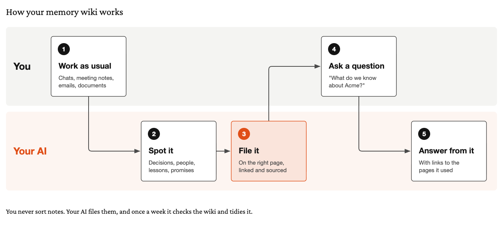
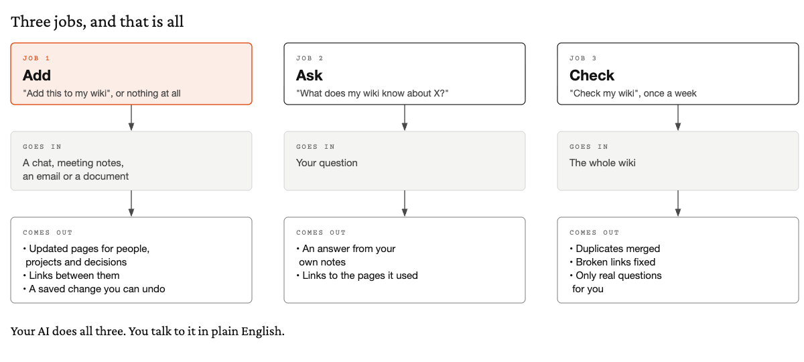

# Wiki memory skill

**A second brain that fills itself.** As you work, your AI helper remembers what matters about the people you know, your projects and the decisions you make. It files each thing on its own page, links the pages together and keeps them tidy. Later you ask it a question and it answers from your own notes, with links to show where each answer came from.

Made by [Remote Humans](https://www.remotehumans.ai/)

## Who's it for

- Business owners and consultants who keep the whole business in their head
- Small teams who lose what was agreed in last month's meeting
- Anyone tired of explaining the same background to their AI every time

## The big picture



## What you can say

| You say | You get |
|---|---|
| **Nothing.** You just work with your AI as usual | Decisions, people, lessons and promises filed as they come up |
| *"Add this to my wiki"* and paste meeting notes, an email or a document | The right pages updated, linked together, with the source noted |
| *"What does my wiki know about Acme?"* | An answer from your own notes, with links to the pages it used |
| *"Check my wiki"* | Duplicates merged, broken links fixed, and only real questions for you |
| *"What changed this week?"* | A short list of what your AI filed and changed |

## Three jobs, and that is all



The idea comes from Andrej Karpathy. Most notes apps hand you a pile of notes to sort. Here your AI keeps one tidy page for each person, project or decision. It updates that page every time something new comes up.

## What is in your wiki


Your wiki is a folder of plain text files on your own computer. Each page links to the others, and every fact says where it came from. You can open it in any notes app, like [Obsidian](https://obsidian.md/), or just read the files.

Your AI saves every change with Git, a free tool that keeps a history of the folder. If it ever files something wrong, you can go back.

## What you need


- **An AI helper** that can read files and run commands, like Claude Code or Codex
- **Python 3 and Git.** Both are free. Your AI helper can check you have them and help you install them.
- **If you like:** a private GitHub repository, so your wiki has a backup and works on more than one computer
- **If you like:** Obsidian, to read and browse your wiki as linked pages

## How to start

1. **Add the skill to your AI helper.** Copy it into your helper's skills folder:

   ```bash
   git clone https://github.com/remotehumans/wiki-memory-setup.git ~/.claude/skills/wiki-memory-setup
   ```

   For Codex, use `~/.codex/skills/wiki-memory-setup` in place of `~/.claude/skills/wiki-memory-setup`.
2. **Restart your AI helper**, so it finds the new skill.
3. **Ask it to set you up.** Say: *"Set up my memory wiki in my Documents folder."* It makes the folders, the index and a short guide called `START_HERE.md`.
4. **Give it something to remember.** Paste the notes from your last meeting and say: *"Add this to my wiki."*
5. **Ask it a question.** Try: *"What does my wiki know about that client?"*
6. **Keep working as usual.** Your AI files new things as they come up. Once a week, say *"Check my wiki"*, or ask your AI helper to schedule it.

## What it costs

- **Your AI helper:** the plan you already pay for
- **Everything else:** free. The wiki is plain files on your computer.
- **Your time:** about ten minutes to set up

## Why it works


Every new chat with an AI starts from nothing. You explain your business, your clients and what you decided last time, again and again. A wiki gives your AI a memory that lasts. It reads what it already knows before it answers, and it adds what it learns as you go. Every week the wiki knows a little more about your world, and you never had to sort a single note.

## What it will not do

- It will not save small talk. Only things worth knowing next month.
- It will not make things up. Every fact on a page says where it came from.
- It will not ask you to sort or approve every note. It asks only when it is truly unsure.
- It will not connect to your email or calendar unless you ask it to.
- It will not put your wiki online. It stays on your computer, unless you add a private backup.

## Questions

**Do I need to know how to code?** No. Your AI helper runs the commands. You talk to it in plain English.

**Which AI helpers work?** Any that can read files and run commands: Claude Code, Codex, Cursor, Gemini CLI and others.

**Is my data private?** Yes. Your wiki is a folder on your computer. It only goes online if you set up a private backup yourself.

**Can my team share one wiki?** Yes. Put it in a private GitHub repository and give each person's AI helper a copy. Git keeps everyone's changes in step.

**What if the AI files something wrong?** Tell it, and it fixes the page. Every change is saved, so you can also go back to an earlier version.

**Does it work with Obsidian?** Yes. The wiki is a folder of Markdown files with links, which is what Obsidian reads.

## What is inside

| File or folder | What it holds |
|---|---|
| `SKILL.md` | The steps your AI helper follows to add, ask and check |
| `references/` | The method: Karpathy's pattern, the page format, the daily workflows and how to run it for a client |
| `scripts/init_llm_wiki.py` | Makes a new wiki with all its folders |
| `scripts/validate_llm_wiki.py` | Checks every page is well formed and every link works |
| `scripts/wiki_status.py` | A quick health report: pages, open questions and last change |
| `docs/` | The pictures in this guide. `python3 docs/make_diagrams.py` rebuilds the diagrams |

## Licence

Free to use and adapt for your own business, with credit to [Remote Humans](https://www.remotehumans.ai/). You may not sell the skill or a version of it. [CC BY-NC 4.0](https://creativecommons.org/licenses/by-nc/4.0/); the full text is in `LICENSE`.
