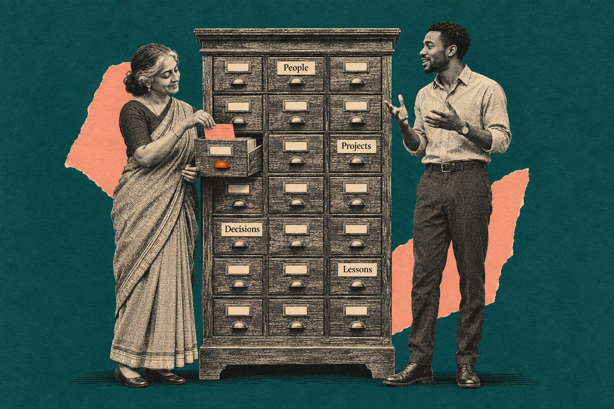
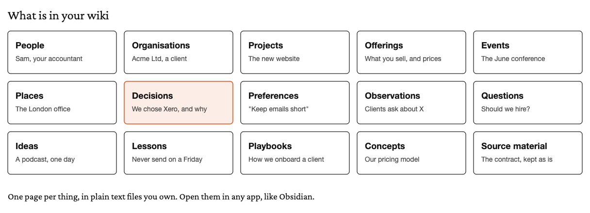
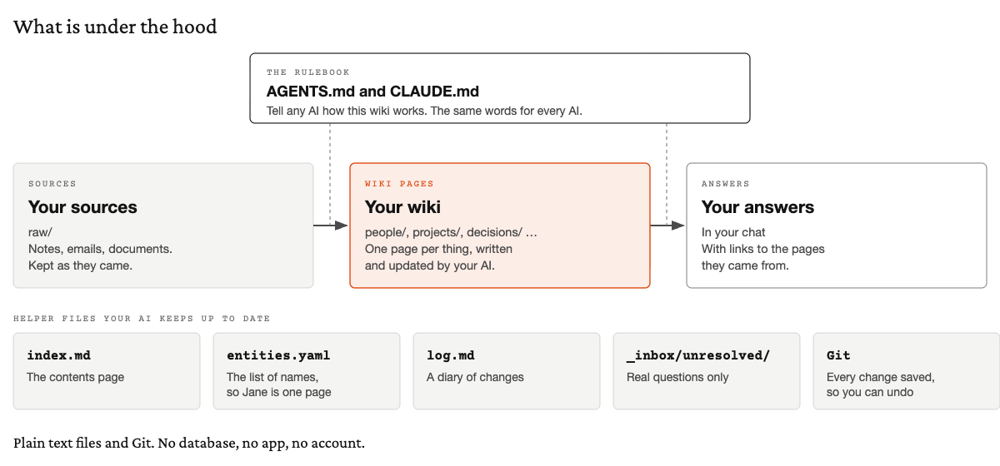

# Wiki memory skill

**A second brain that fills itself.** As you work, your AI helper remembers what matters about the people you know, your projects and the decisions you make. It files each thing on its own page, links the pages together and keeps them tidy. Later you ask it a question and it answers from your own notes, with links to show where each answer came from.

Made by [Remote Humans](https://www.remotehumans.ai/)

## Who's it for

- Business owners and consultants who keep the whole business in their head
- Small teams who lose what was agreed in last month's meeting
- Anyone tired of explaining the same background to their AI every time

## The big picture


## What you can say

| You say | You get |
|---|---|
| **Nothing.** You just work with your AI as usual | Decisions, people, lessons and promises filed as they come up |
| *"Add this to my wiki"* and paste meeting notes, an email or a document | The right pages updated, linked together, with the source noted |
| *"What does my wiki know about Acme?"* | An answer from your own notes, with links to the pages it used |
| *"Who do I need to follow up with?"* | The people due a follow-up, soonest first, with what you promised |
| *"Check my wiki"* | Duplicates merged, broken links fixed, and only real questions for you |
| *"What changed this week?"* | A short list of what your AI filed and changed |

## Three jobs, and that is all


The idea comes from Andrej Karpathy. Most notes apps hand you a pile of notes to sort. Here your AI keeps one tidy page for each person, project or decision. It updates that page every time something new comes up.

## What is in your wiki



Your wiki is a folder of plain text files, kept wherever you choose. Each page links to the others, and every fact says where it came from. You can open it in any notes app, like [Obsidian](https://obsidian.md/), or just read the files.

Every change is kept in a history, so if your AI ever files something wrong, you can go back. On GitHub that history comes from Git. On Google Drive, OneDrive, SharePoint or Dropbox it comes from the provider's version history.

## How it works under the hood



There are three layers, taken from Andrej Karpathy's [LLM Wiki](https://gist.github.com/karpathy/442a6bf555914893e9891c11519de94f) pattern:

1. **Your sources.** The notes, emails and documents you share. If the exact wording matters, your AI keeps a copy in `raw/` and never changes it.
2. **Your wiki.** One page for each person, project, decision or lesson. Your AI writes these pages and keeps them up to date.
3. **The rulebook.** `AGENTS.md` tells any AI how your wiki works: where things go, how to name them and how to check its work. `CLAUDE.md` points Claude to the same file, so Claude, Codex and other tools all follow one set of rules.

### What a new wiki looks like

```text
my-wiki/
├── START_HERE.md        A short guide for you
├── AGENTS.md            The rulebook every AI follows
├── CLAUDE.md            Points Claude to AGENTS.md
├── index.md             The main contents page, pointing to each folder's own contents page
├── entities.yaml        The list of names, so "Jane" and "Jane Doe" stay one page
├── log.md               A diary of what changed and when
├── people/              One page per person, with contact details and follow-up dates
├── organisations/       One page per company, client or supplier
├── projects/            ...and 13 more folders like these
├── raw/                 Original sources, kept as they came
├── _templates/          Starting points for new pages, like a person page
├── _views/              A follow-up table for Obsidian
├── _inbox/unresolved/   Only the things your AI is truly unsure about
└── tools/               The checks your AI runs after every change
```

### What a page looks like

Each page is a plain text file. A short header at the top says what kind of page it is. The body is in plain English, and the sources are listed at the end.

```markdown
---
type: person
title: Sam Patel
description: Our accountant at Patel & Co since 2024
timestamp: 2026-11-14T10:00:00Z
---

# Sam Patel

Sam runs the books for [Acme Ltd](/organisations/acme-ltd.md) and files our VAT
returns each quarter. Prefers email to calls. Suggested we move to
[Xero](/decisions/move-to-xero.md) in March.

# Citations

[1] Meeting notes, 14 November 2026
```

### What happens when you add something

1. Your AI reads the whole source.
2. It looks in the contents page and the list of names, to find pages that already exist.
3. It works out which pages the source changes. One meeting might update a person, a project and a decision.
4. It updates those pages, replacing anything out of date, rather than adding another note on top.
5. It adds links between the pages and notes where each fact came from.
6. It updates the contents page and the diary.
7. It runs a check to make sure every page and link is sound.
8. It saves the change with Git.

## Why it's built this way

- **One page per thing, not one note per meeting.** Most notes apps pile up notes. Your AI then has to search scraps and piece the answer together each time. Here the AI does that work once, when something new arrives, so every answer starts from a page that is already up to date. This is the core idea in [Karpathy's pattern](https://gist.github.com/karpathy/442a6bf555914893e9891c11519de94f).
- **The AI does the filing.** Most second brains fail because people stop sorting their notes. Here nobody sorts. Your AI files as you go and only asks you when it is truly unsure.
- **Plain text files you own.** No app, database or account to lose. Any AI, any notes app and any computer can read them, today and in ten years.
- **History wherever you keep it.** Every change is saved and can be undone. GitHub is recommended because Git records each change and AI tools work well with it, but Google Drive, OneDrive, SharePoint and Dropbox keep their own version history too.
- **Starter folders.** The fifteen folders tell your AI where to put things and where to look first. A new folder is added only when a new kind of thing keeps coming up, so the structure grows with you.
- **A list of names.** People get called different things: "Jane", "Jane Doe", "JD". The name list keeps them on one page, so facts about one person never end up in three places.
- **Sources on every fact.** You can always check where something came from, and your AI can tell which version is newer when two sources disagree.
- **Contents pages, not a search engine.** Each folder has its own contents page, and the main one points to them, so your AI reads only what it needs. For hundreds of pages, good contents pages and plain search are enough. There is nothing extra to set up or pay for. You can add smarter search later if your wiki outgrows it.
- **One rulebook for every AI.** `AGENTS.md` holds the rules and `CLAUDE.md` points to it, so there is one copy to keep up to date and you can switch between Claude, Codex and other tools without the wiki changing shape.
- **A shared page format.** Pages follow Google's [Open Knowledge Format](https://github.com/GoogleCloudPlatform/knowledge-catalog/blob/main/okf/SPEC.md), so other tools can read your wiki too.
- **A weekly check, not a daily chore.** Filing happens as you go. Once a week your AI looks for duplicates, broken links and out-of-date facts, then fixes them.

## What you need


- **An AI helper that can work with files on your computer**, like Claude desktop with Cowork, Claude Code, Codex or Cursor
- **Python 3.** It is free, and your AI helper can check for it and help you install it
- **Somewhere to keep it:** a private GitHub repository (recommended), Google Drive, OneDrive, SharePoint, Dropbox or just your computer. Git is needed only for GitHub
- **If you like:** Obsidian, to read and browse your wiki as linked pages

## How to start

1. **Give your AI helper this link.** Say: *"Set up my memory wiki using https://github.com/remotehumans/wiki-memory-setup"*
2. **Answer its questions.** It asks what the wiki is for, where to keep it and whether you want follow-up reminders. It installs the skill, builds the wiki and walks you through GitHub or your cloud drive if you pick one.
3. **Try it.** It asks about one person you spoke to recently, files them, then shows you what the wiki knows about them.
4. **Keep working as usual.** Your AI files new things as they come up. Once a week, say *"Check my wiki"*, or ask your AI helper to schedule it.

If your helper cannot use the link, copy the skill into its skills folder yourself, then restart it:

```bash
git clone https://github.com/remotehumans/wiki-memory-setup.git ~/.claude/skills/wiki-memory-setup
```

For Codex, use `~/.codex/skills/wiki-memory-setup` in place of `~/.claude/skills/wiki-memory-setup`.

**Already have a wiki from an earlier version?** Say: *"Upgrade my memory wiki."* Your AI adds the person template, contents pages and follow-up rules without changing your pages.

## What it costs

- **Your AI helper:** the plan you already pay for
- **Everything else:** free. The wiki is plain files on your computer.
- **Your time:** about ten minutes to set up

## Why it works


Every new chat with an AI starts from nothing. You explain your business, your clients and what you decided last time, again and again. A wiki gives your AI a memory that lasts. It reads what it already knows before it answers, and it adds what it learns as you go. Every week the wiki knows a little more about your world, and you never had to sort a single note.

## What it will not do

- It will not save small talk. Only things worth knowing next month.
- It will not make things up. Every fact on a page says where it came from.
- It will not ask you to sort or approve every note. It asks only when it is truly unsure.
- It will not connect to your email or calendar unless you ask it to.
- It will not put your wiki in a public place. It stays where you choose: your computer, a private GitHub repository or your own cloud drive.

## Questions

**Do I need to know how to code?** No. Your AI helper runs the commands. You talk to it in plain English.

**Which AI helpers work?** Any that can read files and run commands: Claude desktop with Cowork, Claude Code, Codex, Cursor, Gemini CLI and others.

**Can I use it in ChatGPT or Claude.ai?** Yes, for questions. Connect the GitHub repository or cloud folder that holds your wiki, and those apps can answer from it. Most connectors only read, so new notes are filed by a helper that can write files.

**Can it remind me to follow up with people?** Yes, if you want it to. During setup your AI asks whether you want reminders, and whether you want just a list of names or draft messages too. It never sends anything for you.

**Is my data private?** Yes. Your wiki is a folder you control, on your computer, a private GitHub repository or your own cloud drive.

**Can my team share one wiki?** Yes. Put it in a private GitHub repository and give each person's AI helper a copy. Git keeps everyone's changes in step.

**What if the AI files something wrong?** Tell it, and it fixes the page. Every change is saved, so you can also go back to an earlier version.

**Does it work with Obsidian?** Yes. The wiki is a folder of Markdown files with links, which is what Obsidian reads.

## What is inside

| File or folder | What it holds |
|---|---|
| `SKILL.md` | The steps your AI helper follows to add, ask and check |
| `references/` | The method: Karpathy's pattern, the page format, the daily workflows, storage and connector choices, follow-up reminders and how to run it for a client |
| `scripts/init_llm_wiki.py` | Makes a new wiki with all its folders, or upgrades an older one |
| `scripts/validate_llm_wiki.py` | Checks every page is well formed and every link works |
| `scripts/wiki_status.py` | A quick health report: pages, open questions and last change |
| `docs/` | The pictures in this guide. `python3 docs/make_diagrams.py` rebuilds the diagrams |

## Licence

Free to use and adapt for your own business, with credit to [Remote Humans](https://www.remotehumans.ai/). You may not sell the skill or a version of it. [CC BY-NC 4.0](https://creativecommons.org/licenses/by-nc/4.0/); the full text is in `LICENSE`.
